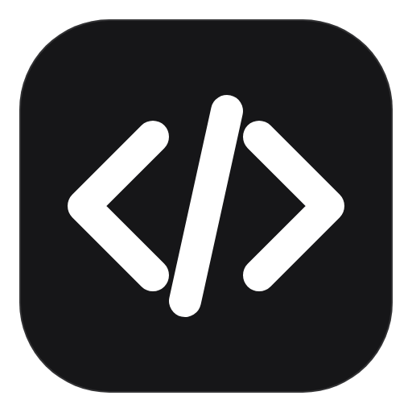
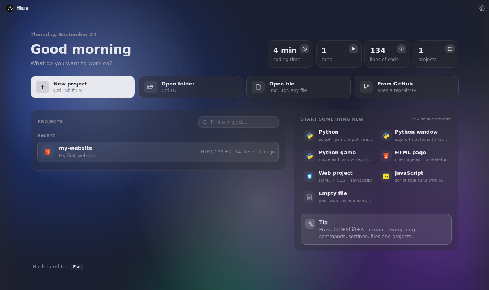
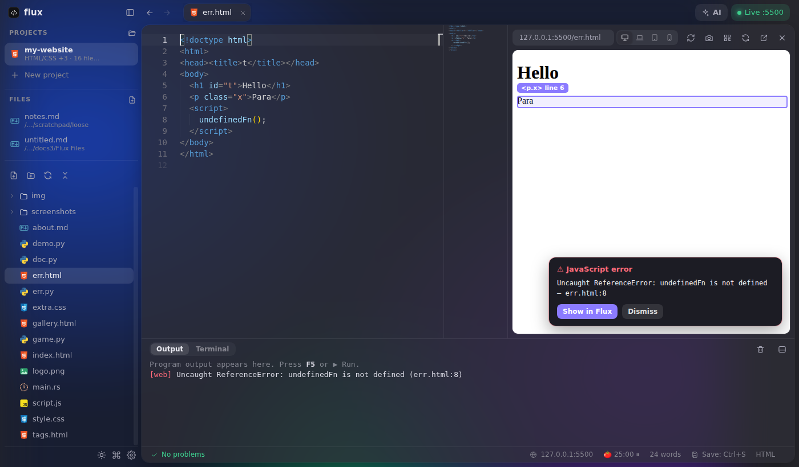
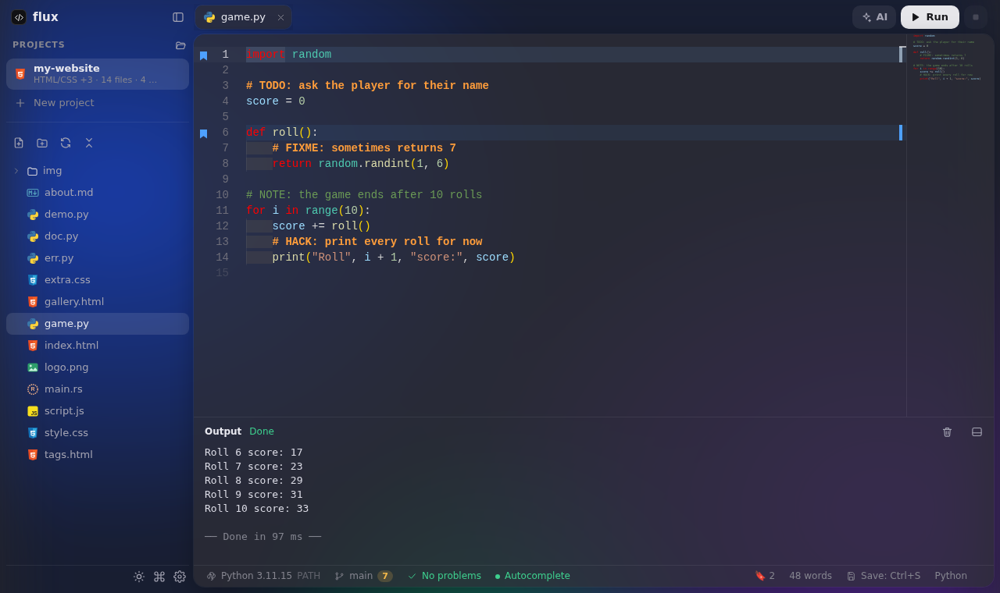
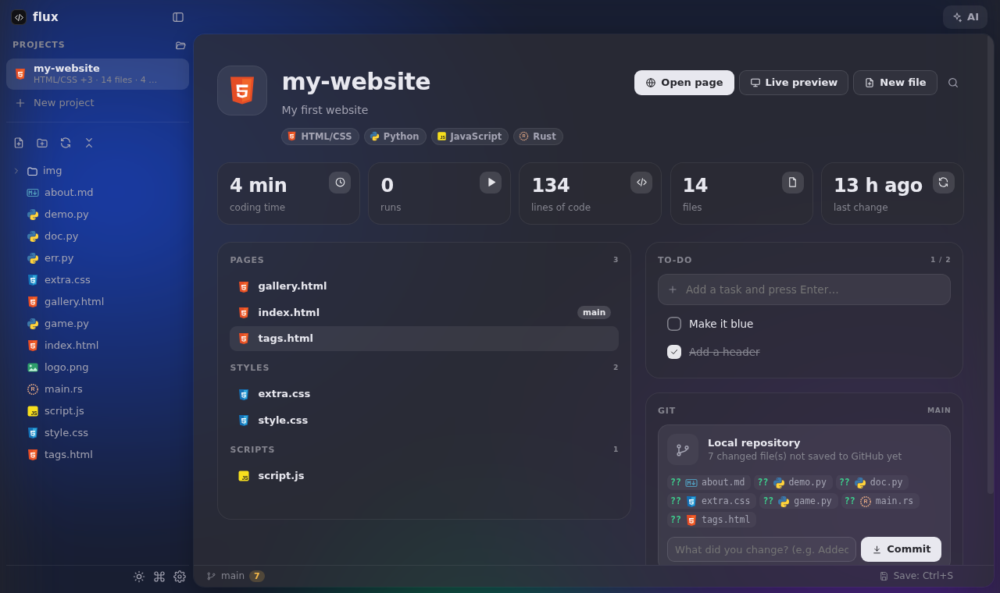
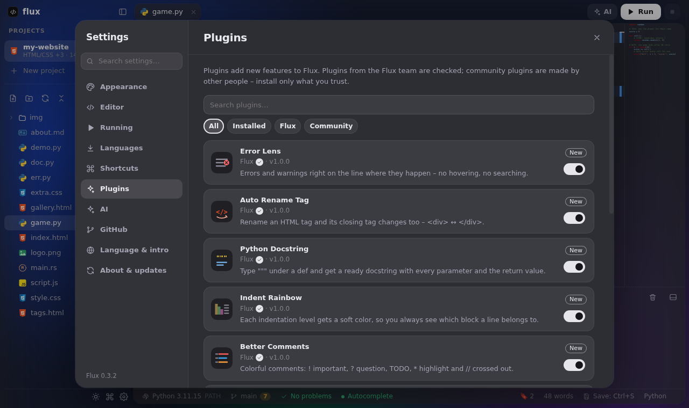

<p align="center">
  
</p>

<h1 align="center">Flux</h1>

<p align="center">
  A small, modern code editor for Windows 11 – run your code with one click, see websites live, get help from AI.
  <br><br>
  <a href="https://pantr1x.github.io/Flux/"><b>Website</b></a>
  &nbsp;·&nbsp;
  <a href="https://pantr1x.github.io/Flux/#releases"><b>Download (Windows &amp; Linux)</b></a>
  &nbsp;·&nbsp;
  <a href="CHANGELOG.md">What's new</a>
  &nbsp;·&nbsp;
  <a href="https://github.com/pantr1x/Flux/wiki">Wiki</a>
  &nbsp;·&nbsp;
  <a href="https://github.com/pantr1x/Flux/wiki/Making-plugins">Make a plugin</a>
</p>

<p align="center">
  <a href="https://github.com/pantr1x/Flux/releases/latest"></a>
  <a href="https://github.com/pantr1x/Flux/releases"></a>
  
  <a href="https://github.com/pantr1x/Flux/stargazers"></a>
</p>

<p align="center">
  
</p>

## Why Flux

- **Made for learning and small projects.** Open Flux, press **F5**, and your code runs. You do not have to set anything up first.
- **Light.** The installer is small, languages are downloaded only when you need them, and a *Save memory* mode helps on older PCs.
- **Everything in one window.** Code, program output, a terminal, a live website preview, Git and AI help.
- **Yours to change.** Themes, fonts, colors and shortcuts, plus plugins that anyone can write in a few lines of JavaScript.

## Install

### Windows

Download [`Flux-Native.exe`](https://github.com/pantr1x/Flux/raw/ci-native/Flux-Native.exe) and run it – nothing to install. Windows may show *"Windows protected your PC"* because Flux is not signed yet – click **More info → Run anyway**. Flux keeps itself up to date (Settings → General → About & updates).

### Linux (x86_64)

Pick one. Packages are built on every release and live on the [`ci-native-linux`](https://github.com/pantr1x/Flux/tree/ci-native-linux) branch.

| How | Command |
|---|---|
| **Script** (any distro, updates itself) | `curl -fsSL https://pantr1x.github.io/Flux/install.sh \| bash` |
| **Arch / CachyOS / Manjaro (pacman)** | `echo -e '\n[flux]\nSigLevel = Optional TrustAll\nServer = https://raw.githubusercontent.com/pantr1x/Flux/ci-native-linux/pacman' \| sudo tee -a /etc/pacman.conf && sudo pacman -Sy flux-editor` |
| **Flatpak** | `flatpak remote-add --user --if-not-exists flux https://raw.githubusercontent.com/pantr1x/Flux/ci-native-linux/Flux.flatpakrepo && flatpak install --user -y flux dev.flux.Flux` |
| **Debian / Ubuntu (apt)** | `echo 'deb [trusted=yes] https://raw.githubusercontent.com/pantr1x/Flux/ci-native-linux/apt stable main' \| sudo tee /etc/apt/sources.list.d/flux.list && sudo apt update && sudo apt install flux-editor` |
| **Fedora (dnf)** | `sudo curl -fsSLo /etc/yum.repos.d/flux.repo https://raw.githubusercontent.com/pantr1x/Flux/ci-native-linux/flux.repo && sudo dnf install flux-editor` |

- The repository is added once; after that Flux installs and updates like any other package (`pacman -Syu`, `apt upgrade`, `dnf upgrade`, `flatpak update`). The command to start it is `flux`.
- **Package names:** `flux-editor` (pacman, apt, dnf; it provides `flux`) and `dev.flux.Flux` (Flatpak). The repositories are not signed yet, so the commands trust them explicitly. Flux is not in the distributions' own repositories (yet), so `pacman -Ss flux` finds it only after you add `[flux]`.
- Without a repository on Arch: `curl -fsSLO https://raw.githubusercontent.com/pantr1x/Flux/ci-native-linux/PKGBUILD && makepkg -si`.
- Uninstall the script version with `curl -fsSL https://pantr1x.github.io/Flux/install.sh | bash -s -- --uninstall`. Package versions: `sudo pacman -Rns flux-editor`, `sudo apt remove flux-editor`, `sudo dnf remove flux-editor`, `flatpak uninstall dev.flux.Flux`.

Programming languages are not bundled, so Flux stays small. It downloads only the ones you pick, from their official sources.

## What it does

| | |
|---|---|
|  **One-click Run** | Press **F5** to run Python, JavaScript, TypeScript, Java, C/C++, C#, Go, Rust, Ruby, PHP, Lua, Perl, Zig, R, Julia or shell scripts. `input()`, colors and windows (tkinter, turtle, pygame) work. Missing languages are installed for you. |
|  **Live Server** | A preview of your website right next to the code that reloads on save. **Alt+click** any element to jump to its line in the HTML, JavaScript errors show up on the page with a *Show in Flux* button, preview as laptop, tablet or phone (and rotate it), take a screenshot, or scan a QR code to open the page on your real phone. |
|  **Smart editor** | Autocomplete and error checking for Python (Pyright), HTML, CSS and JavaScript, Emmet, snippets, rename everywhere, auto-closing HTML tags, image previews on hover, Markdown preview. |
|  **Claude AI** | Ask Claude about your code (Ctrl+I) with your own API key. It can read your project and plan your to-do list. Flux also works the other way round: Claude Desktop, Claude Code and Cursor can use your Flux projects through MCP. |
|  **GitHub** | Sign in with GitHub, open any of your repositories as a project, commit and push, or publish a new project with one click. |
|  **Projects and files** | Projects with a description, to-do list and statistics (coding time, runs, lines). Open single files like `.md` or `.txt` without a project, or drop them onto the window. |
|  **Make it yours** | Code themes and a theme studio with live preview, accent colors, text and mouse cursor (also your own picture), fonts, app size, corners, background image, density (compact shows more) and focus mode (F11). 9 app languages: English, Slovak, German, Spanish, French, Italian, Polish, Portuguese and Ukrainian. |
|  **Keyboard first** | Every shortcut can be changed. Search everything with Ctrl+Shift+A, go back and forward with the mouse side buttons or Alt+←/→, run your own scripts from `shortcuts.json`. There is a real terminal next to the program output. |
|  **Plugins** | A plugin store with ratings and screenshots: Error Lens, Auto Rename Tag, Python Docstring, Indent Rainbow, Better Comments, CSS Class Completion, Bookmarks, Color Highlight, Snippet Pack, Word Count, **Theme Pack** (8 more color themes) and **Glass UI**. Plugins can add commands, snippets, styles and color themes – writing your own takes a few lines of JavaScript. GitHub is a built-in plugin you install when you need it. |

<p align="center">
  
</p>

<p align="center">
  
  
</p>

## Shortcuts

| Keys | Action |
|---|---|
| `F5` / `Shift+F5` | Run / stop |
| `Alt+L` | Live Server on / off |
| `Ctrl+Shift+A` | Search everything |
| `Ctrl+Shift+P` | Commands |
| `Ctrl+P` | Open a file of the project |
| `Ctrl+Alt+O` | Open any file |
| `Ctrl+I` | Claude AI |
| `Ctrl+Shift+V` | Markdown preview |
| `F11` | Focus mode – only the code |
| ``Ctrl+Shift+` `` | Terminal |
| `Alt+←` / `Alt+→` | Back / forward |
| `Alt+click` in the preview | Jump to that element in the HTML |
| `Ctrl+,` | Settings |

All of them can be changed in Settings → General → Shortcuts.

## Plugins

<p align="center">
  
</p>

Plugins live in [`plugins/`](plugins) and are installed from **Settings → Plugins**.

- **Make one:** press **Create a plugin** in Settings → Plugins, then follow [Making plugins](https://github.com/pantr1x/Flux/wiki/Making-plugins) in the wiki. The full reference is the [plugin guide](docs/PLUGINS.md).
- **Publish it:** fork this repository, add your plugin folder and open a pull request ([how](https://github.com/pantr1x/Flux/wiki/Publishing-plugins)).
- **Safety:** every plugin pull request gets an **automatic review**. Fixed rules block dangerous code, and an AI review looks for malware and data theft. The plugin code is only read during the review, never run. A maintainer gives the final OK.

## Privacy

Flux has no accounts, ads or tracking.

- **Internet:** it only goes online to check for updates, to show the plugin store, to download the languages and plugins you choose, and for the features you turn on: GitHub, and Claude AI with your own API key.
- **Settings and projects** stay on your PC.

## Contributing

Bug reports and ideas are welcome in [Issues](https://github.com/pantr1x/Flux/issues). Plugins are the easiest way to add a feature, see [Plugins](#plugins).

## Build it yourself

```bash
npm install
npm start          # run Flux from the source
npm run dist       # build the Windows installer into release/
```

Flux is built with Electron, Monaco (the editor of VS Code), xterm.js and basedpyright.

The website in [`site/`](site) is published to GitHub Pages by the *Website* workflow (branch `gh-pages`). How the website, releases and the rest of the repository work is described in [`CLAUDE.md`](CLAUDE.md).

A new version is released by raising `version` in `package.json` and adding its notes to `CHANGELOG.md` – GitHub Actions builds the installer and publishes the release, and installed copies update themselves.

## License and code signing

Flux is open source under the [MIT License](LICENSE). Flux Native builds for Windows are built from this repository on GitHub Actions and code-signed
as described in the [code signing policy](docs/CODE-SIGNING.md) (free signing for open-source projects by the [SignPath Foundation](https://signpath.org/foundation)).

