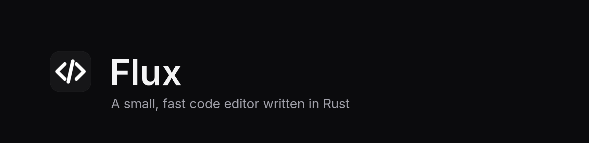
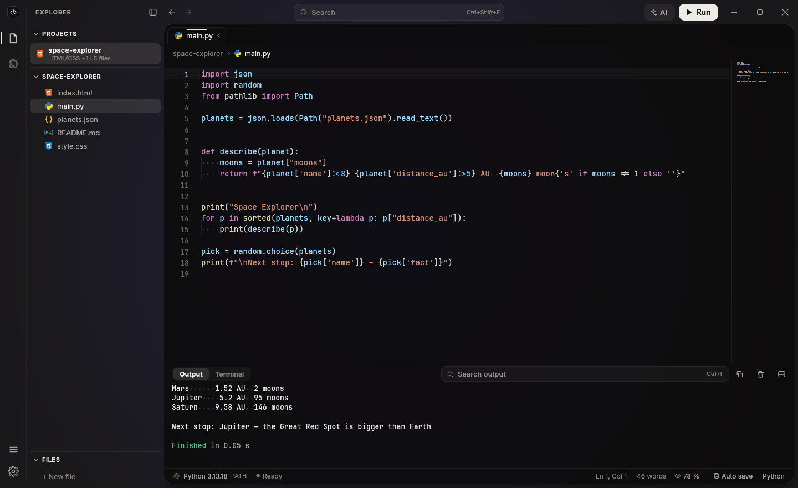
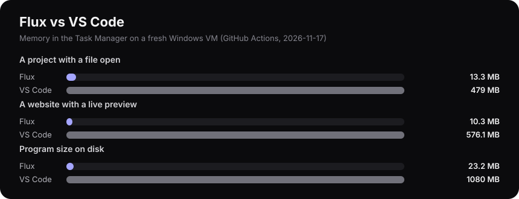
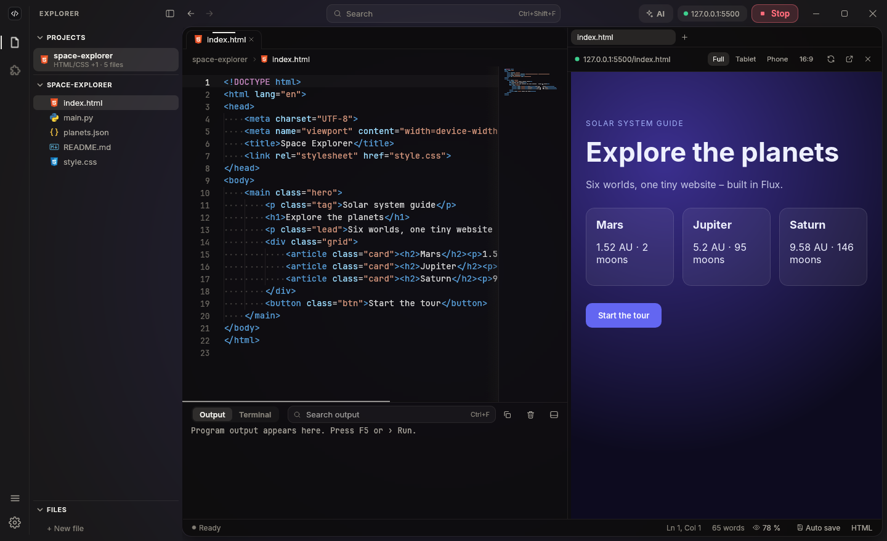
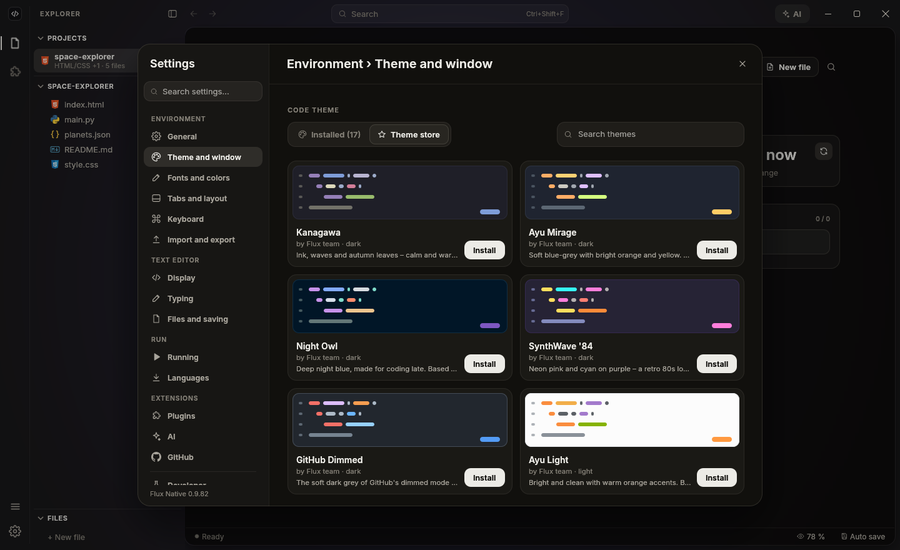
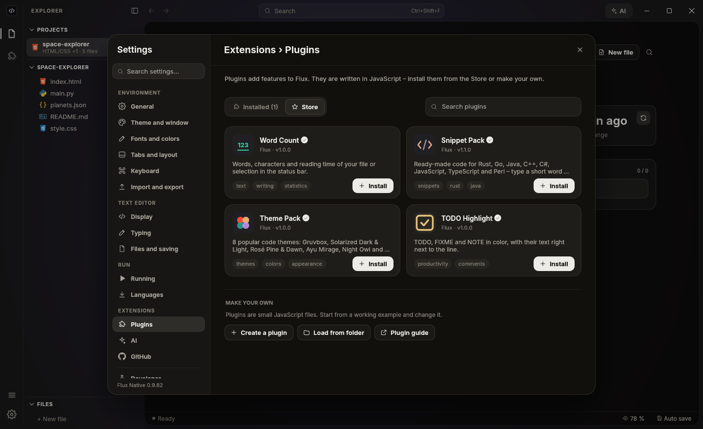

<p align="center">
  
</p>

<p align="center">
  Run your code with one click, see your website change as you type, get help from Claude AI – with nothing to set up.
  <br><br>
  <a href="https://pantr1x.github.io/Flux/"><b>Website</b></a>
  &nbsp;·&nbsp;
  <a href="https://github.com/pantr1x/Flux/raw/ci-native/Flux-Native.exe"><b>Download for Windows</b></a>
  &nbsp;·&nbsp;
  <a href="#install">Install on Linux</a>
  &nbsp;·&nbsp;
  <a href="native/CHANGELOG.md">What's new</a>
  &nbsp;·&nbsp;
  <a href="docs/PLUGINS.md">Make a plugin</a>
</p>

<p align="center">
  
  
  
  <a href="LICENSE"></a>
  <a href="https://github.com/pantr1x/Flux/stargazers"></a>
</p>

<p align="center">
  
</p>

## Why Flux

- **Small and fast.** One native program (no browser engine inside): about 15 MB to download and about 14 MB of memory.
- **Ready right away.** Open Flux, press **F5**, your code runs. Languages you don't have yet download from their official sources.
- **Everything in one window.** Code, program output, a terminal, a live website preview, GitHub and AI help.
- **Yours to change.** Themes, fonts, colors, a see-through window, shortcuts – and plugins anyone can write in a few lines of JavaScript.

## Flux vs VS Code

<p align="center">
  <a href="https://github.com/pantr1x/Flux/actions/workflows/compare.yml"></a>
</p>

Measured automatically on a fresh Windows VM by [GitHub Actions](https://github.com/pantr1x/Flux/actions/workflows/compare.yml) ([how](.github/workflows/compare.yml)): the same small project, once with a file open and once with a website and its live preview (Flux Live Server / VS Code Live Preview). Every run and its numbers are public.

## Install

**Windows 10 / 11** – download [`Flux-Native.exe`](https://github.com/pantr1x/Flux/raw/ci-native/Flux-Native.exe) and run it. There is nothing to install. If Windows shows *"Windows protected your PC"*, click **More info → Run anyway**.

**Linux (x86_64)** – one command in the terminal:

```bash
curl -fsSL https://pantr1x.github.io/Flux/install.sh | bash
```

Flux then keeps itself up to date: it checks at start and every hour, downloads in the background (usually only the changed part) and installs when you close it.

## What it does

| | |
|---|---|
| **▶ One-click Run** | **F5** runs Python, JavaScript, TypeScript, Java, C/C++, C#, Go, Rust, Ruby, PHP, Lua, Perl, Zig, R, Julia, Dart and Swift. Select a few lines and Run runs just them – with the imports, functions and variables they need. `input()` works in the output. |
| **🌐 Live Server** | Your website right inside Flux, changing while you type – before you even save. Full, tablet or phone size, links open in tabs, select text on the page to jump to its line in the HTML. |
| **💡 Suggestions that know your code** | Members of the Python modules you really have installed (`platform.` → `release()`), keys of the JSON data your file loads (`data["releases"][0]["kernel_version"]`), HTML and CSS with Emmet, snippets, error hints from the real Python compiler. |
| **📦 Python libraries** | An import you don't have gets underlined – click it and Flux installs it with pip. One window lists what is missing and what can be updated. |
| **🖥 Output and Terminal** | Every file keeps its own output and a real terminal, with a search field that highlights every match. |
| **✦ Claude AI** | Ask Claude about your code (Ctrl+I) with your own API key. Claude Desktop, Claude Code and Cursor can also work with your Flux projects through MCP. |
| **🐙 GitHub** | Sign in with one code, open any of your repositories, or publish a new project. |
| **🎨 Make it yours** | A theme store (try a theme with one click), themes as small text files, see-through or blurred window, fonts, colors and every shortcut. 9 app languages: English, Slovak, German, Spanish, French, Italian, Polish, Portuguese and Ukrainian. |
| **🧩 Plugins** | Word Count, Snippet Pack, Theme Pack, TODO Highlight – and your own, written in JavaScript. |

<p align="center">
  
</p>

<p align="center">
  
</p>

## Shortcuts

| Keys | Action |
|---|---|
| `F5` / `Shift+F5` | Run / stop |
| `Ctrl+Shift+F` | Search everything |
| `Ctrl+Shift+P` | Commands |
| `Ctrl+P` | Open a file of the project |
| `Ctrl+I` | Claude AI |
| ``Ctrl+` `` | Terminal |
| `Ctrl+F` | Find in the file or in the output |
| `Ctrl+Shift+E` | Explorer |
| `Alt+←` / `Alt+→` | Back / forward |
| `Ctrl+,` | Settings |

Every shortcut can be changed in **Settings → Keyboard**.

## Plugins

<p align="center">
  
</p>

Plugins are JavaScript files that run in a small, safe engine inside Flux (QuickJS). They live in [`plugins/`](plugins) and are installed from **Settings → Plugins**.

- **Make one:** press **Create a plugin** in Settings → Plugins, then follow the [plugin guide](docs/PLUGINS.md).
- **Publish it:** fork this repository, add your plugin folder and open a pull request.
- **Safety:** every plugin pull request gets an automatic review – fixed rules block dangerous code and an AI review looks for malware. The code is only read, never run. A maintainer gives the final OK.

Themes work the same way – see [docs/THEMES.md](docs/THEMES.md).

## Privacy

Flux has no accounts, ads or tracking. It only goes online to check for updates, to show the plugin and theme stores, to download languages and plugins you choose, and for features you turn on (GitHub, Claude AI with your own key).

## Build it yourself

You need [Rust](https://rustup.rs) 1.95 or newer.

```bash
cargo run -p flux-native            # start Flux from the source
cargo build -p flux-native --release
cargo test -p flux-native
```

On Linux, install `libxkbcommon-dev libgl1-mesa-dev` first (and `libwebkit2gtk-4.1-dev` for the Live Server preview helper, `crates/flux-preview`).

| Folder | What it is |
|---|---|
| [`native/`](native) | Flux itself (egui) |
| [`crates/flux-core`](crates/flux-core) | settings, files, running code, terminal |
| [`crates/flux-preview`](crates/flux-preview) | Live Server preview window on Linux |
| [`crates/flux-tools`](crates/flux-tools) | translations: `cargo run -p flux-tools -- strings` / `check` / `add` |
| [`locales/`](locales) | app translations |
| [`themes/`](themes), [`plugins/`](plugins) | built-in themes, the theme and plugin stores |
| [`site/`](site) | the website (GitHub Pages) |

Every push builds Flux on GitHub Actions, tests it on Windows and Linux (start, update, memory, Windows Defender scan) and publishes it as the next update.

## License and code signing

Flux is open source under the [MIT License](LICENSE). Windows builds are made from this repository on GitHub Actions; code signing is being set up as described in the [code signing policy](docs/CODE-SIGNING.md) (free signing for open-source projects by the [SignPath Foundation](https://signpath.org/foundation)).
